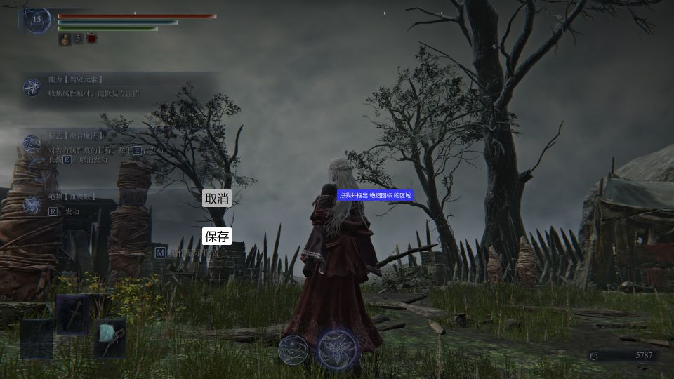
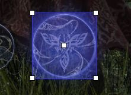

# 绝招倒计时

该功能用于显示绝招效果的倒计时，支持的角色：女爵、隐士、执行者、复仇者、学者。

ℹ️ 只能显示自己使用的绝招效果的倒计时。

## 设置绝招图标区域

1. 在「基本设置」中点击「绝招图标区域」的「标定」，或先为它设置快捷键，然后在游戏中按下快捷键。
2. 在任意有绝招图标的游戏画面下进行标定：画面会定格并出现按钮，点击「点我并框出 绝招图标 的区域」，然后框选绝招图标的区域。

   

   ⚠️ 框选的要求：框和绝招图标的圆的边缘贴合。

   

3. 点击「保存」完成设置，若修改游戏分辨率则需要重新框选。

## 设置绝招快捷键

把「绝招快捷键」设置为你在游戏中使用绝招的按键即可。之后每次按下绝招键，程序会稍等片刻后截图识别绝招图标，识别成功则显示对应的倒计时。
