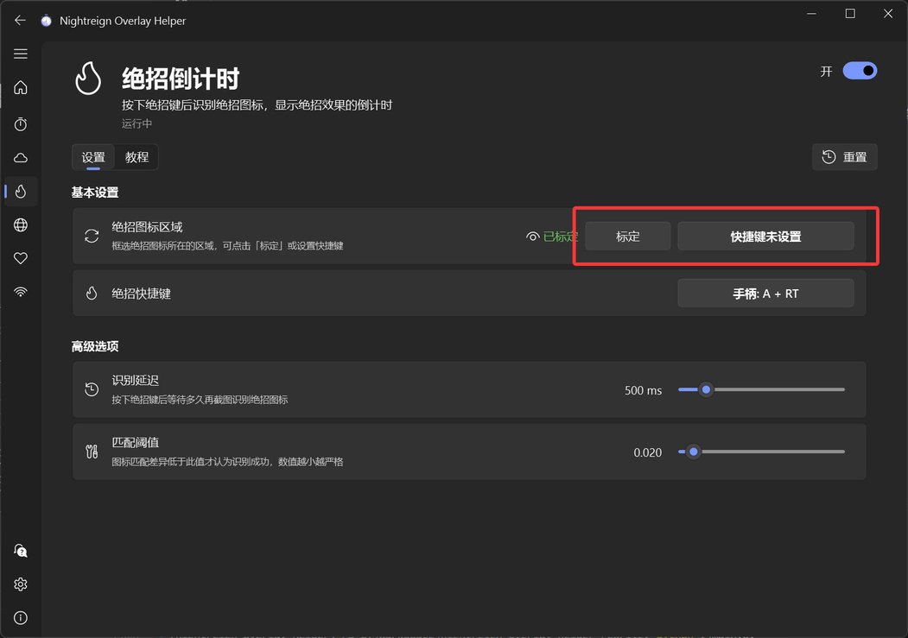
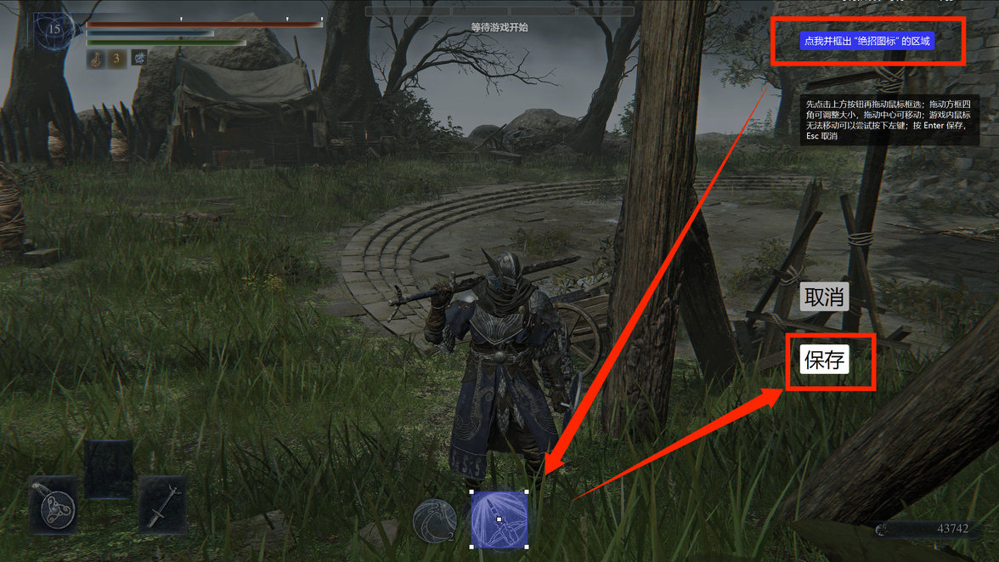
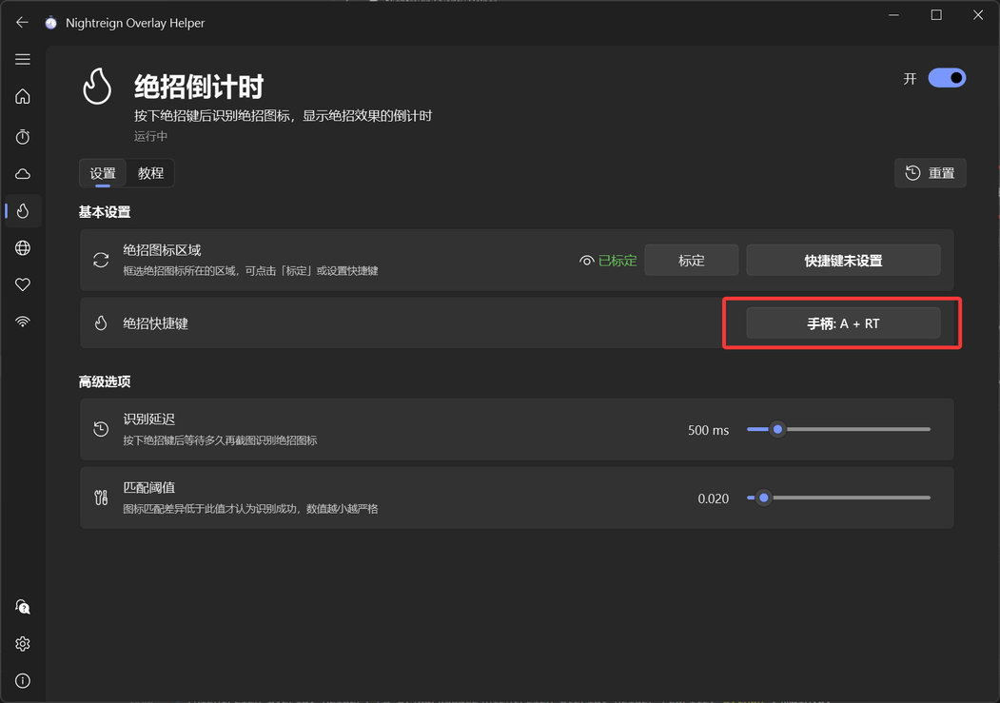
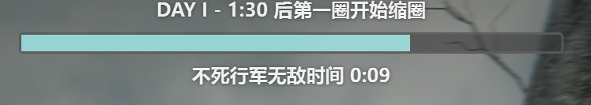

## 功能介紹

在遊戲中按下絕招按鍵且絕招圖示亮起時，懸浮窗會顯示絕招生效時間倒數；支援角色：女爵、隱士、執行者、復仇者、學者。

此外也支援送葬者額外絕招的有效時間倒數。

## 初次設定

### 1. 標定絕招區域。

ℹ️ **注意：此步驟並非必要，程式會根據 16:9 全螢幕遊戲畫面，自動計算要偵測的區域。只有在遊戲並非全螢幕，或自動標定的區域不正確時，才需要依照下方步驟手動標定。**

建議設定控制器或鍵盤快捷鍵，然後進入遊戲中的訓練場或任何會顯示絕招圖示的場景，按下快捷鍵進入標定畫面。

點擊右上角按鈕開始框選（如果滑鼠無法移動，可以嘗試按一下左鍵），框選**緊貼絕招圖示亮色邊緣的區域**（不包含外圍的漸層圈），框選後按 Enter 或儲存按鈕確認。

回到主介面，看到綠色的「已標定」即表示成功；將滑鼠移到眼睛圖示上可以查看已標定的區域。

### 2. 設定遊戲中發動絕招的快捷鍵。

送葬者的絕招不需要按下此快捷鍵即可偵測。

## 效果

可以在一般「設定」中調整主懸浮窗的外觀。

## 注意事項

有時不支援的角色發動絕招時仍會觸發錯誤倒數，這是正常現象，不會影響使用。

其他無法辨識或辨識不準等問題，請參閱「常見問題」頁面。
