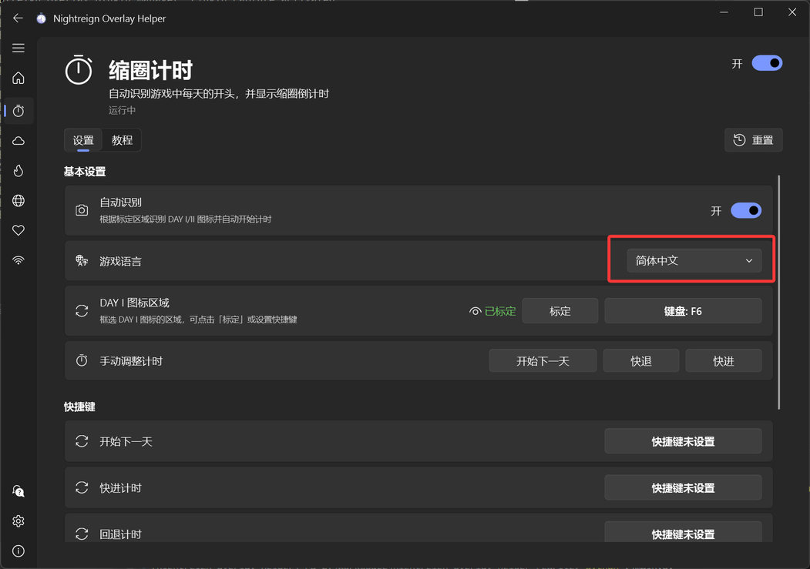
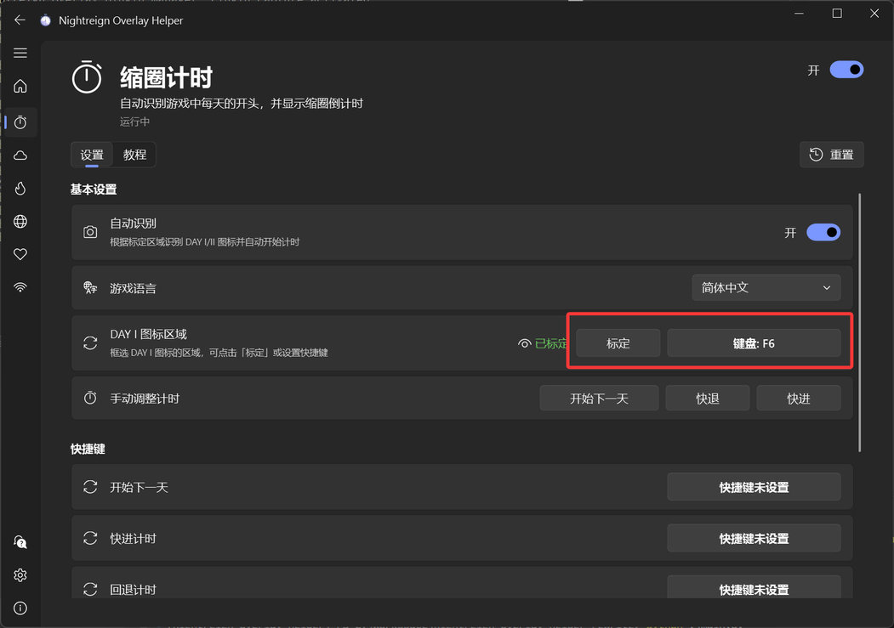
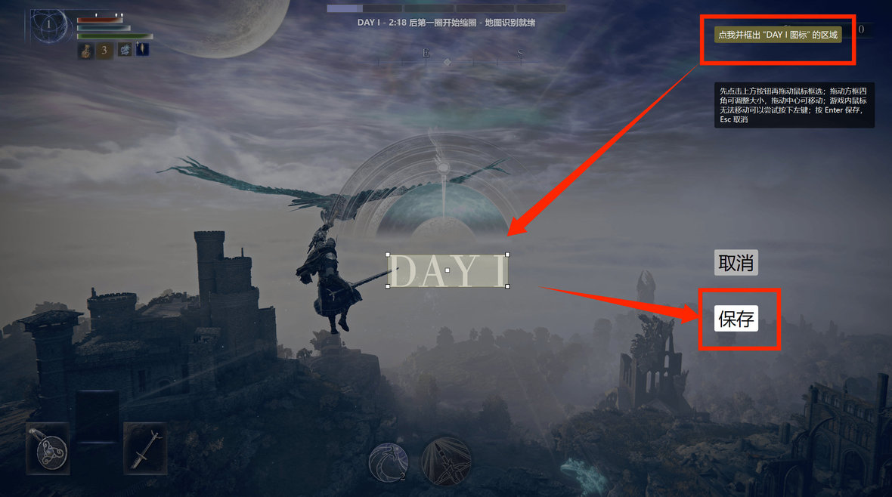
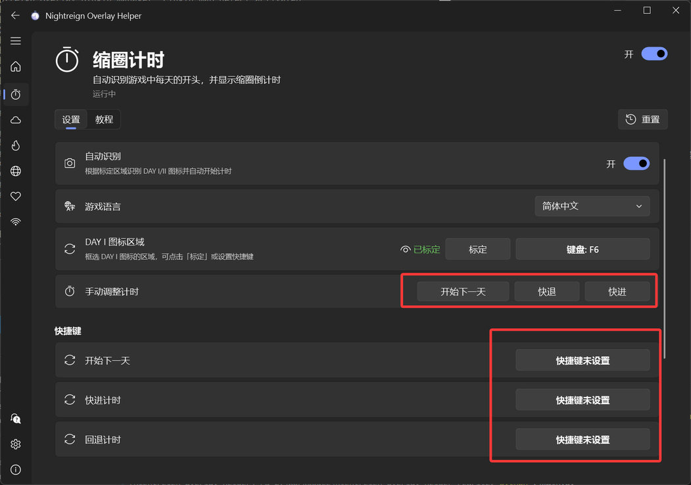

## 功能介绍

通过识别游戏内每天开头的 DAY I / DAY II / DAY III 图标，自动进行缩圈的倒计时，显示在悬浮窗上；也可以通过快捷键手动计时。

## 初次设置

### 1. 选择你的《黑夜君临》的游戏语言。

### 2. 对 DAY I 图标区域进行标定。

ℹ️ **注意：该步骤并非必做，程序会根据 16:9 全屏游戏画面，自动计算出要检测的区域。如果你不是全屏画面，或者自动标定的区域不正确，才需要按下面步骤进行手动标定。**

建议设置手柄或键盘快捷键，然后打开一局单人游戏，在 DAY I 图标完全出现时按下快捷键进入标定界面。

点击右上角按钮开始框选（如果鼠标无法移动可以尝试按一下左键），框选时请尽量贴紧 DAY I 图标（包括字体两侧衬线的突起），框选后按 Enter 或保存按钮进行确认。

回到主界面，看到绿色“已标定”即成功，鼠标悬浮在眼睛图标上可以看到已标定的区域。

### 3. 设置手动快捷键

可以设置手动计时快捷键，也可以直接在主界面启动计时。

## 效果

可以在通用“设置”进行主悬浮窗的外观设置。

## 注意事项

在每天开头，请先等待 DAY X 完整出现后再进行背包或地图的浏览，否则其他界面会覆盖掉 DAY X 图标，导致无法自动开始计时。

一局游戏结束后仍然在进行 DAY III 计时是正常现象，不影响使用。

其他无法识别、识别不准等问题，可参照“常见问题”页面。
