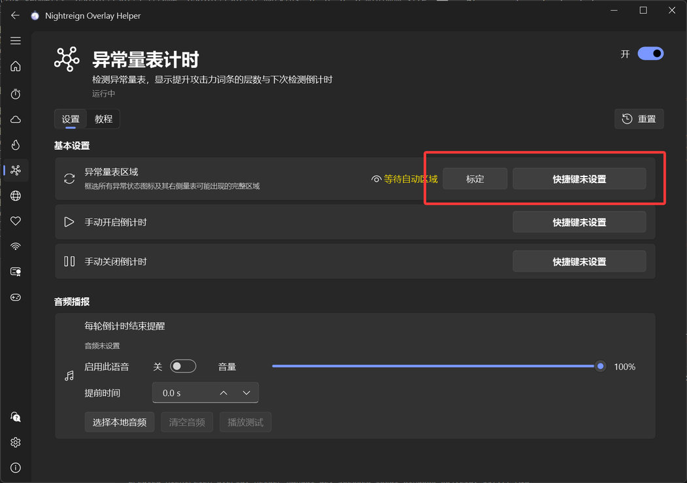
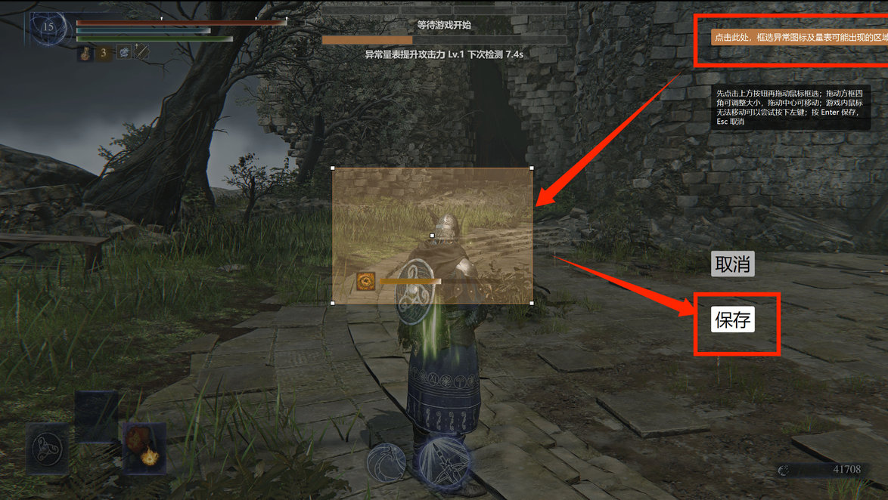

## 功能介绍

检测异常量表，显示废弃物之王遗物词条提升攻击力的层数与下次检测倒计时。

## 初次设定

### 1. 对异常量表区域进行标定

ℹ️ 该步骤**可跳过**，程序会根据 16:9 全屏游戏画面，自动计算出要检测的区域。

如果自动区域无法正常工作、游戏不是全屏，或者想识别其他非游戏窗口，请先查看 [标定教程](app://tutorial/region-calibration)

:::collapse 手动标定步骤

建议设置手柄或键盘快捷键，然后进入游戏中出现异常量表的场景，按下快捷键进入标定界面。

点击右上角按钮开始框选（如果鼠标无法移动可以尝试按一下左键），框选**可能出现异常量表的区域**，框选后按 Enter 或保存按钮进行确认。

回到主界面，看到绿色“已标定”即成功，鼠标悬浮在眼睛图标上可以看到已标定的区域。

:::

## 注意事项

其他无法识别、识别不准等问题，可参照“常见问题”页面。
