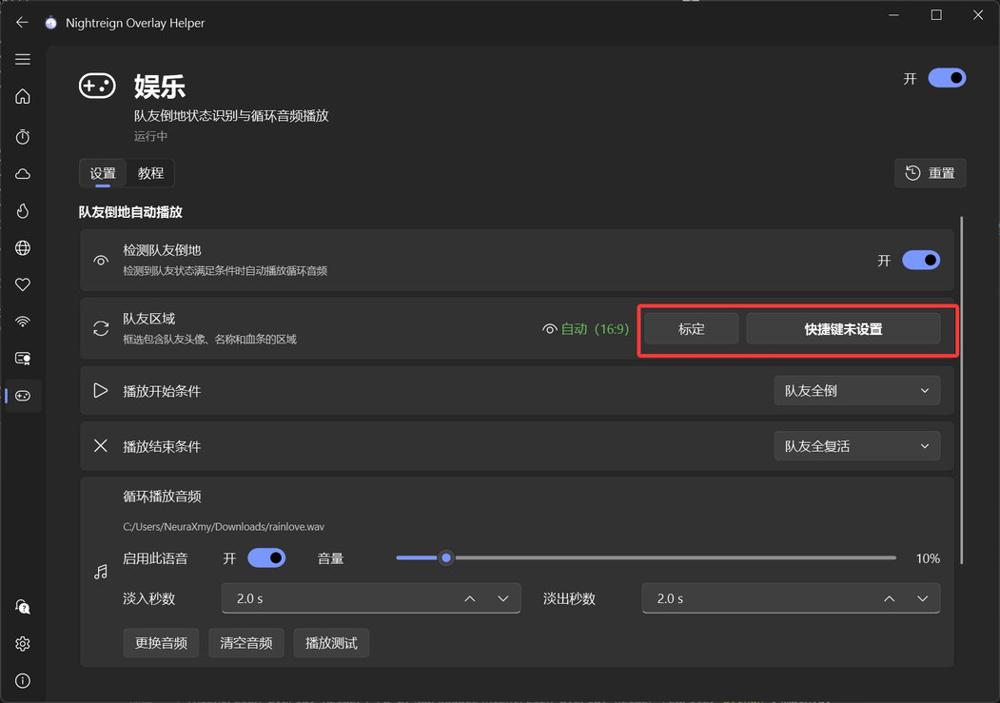
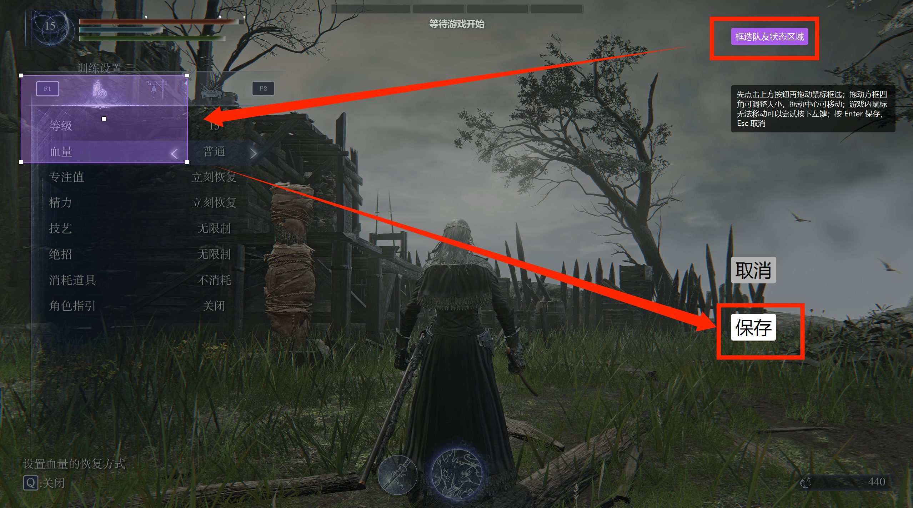
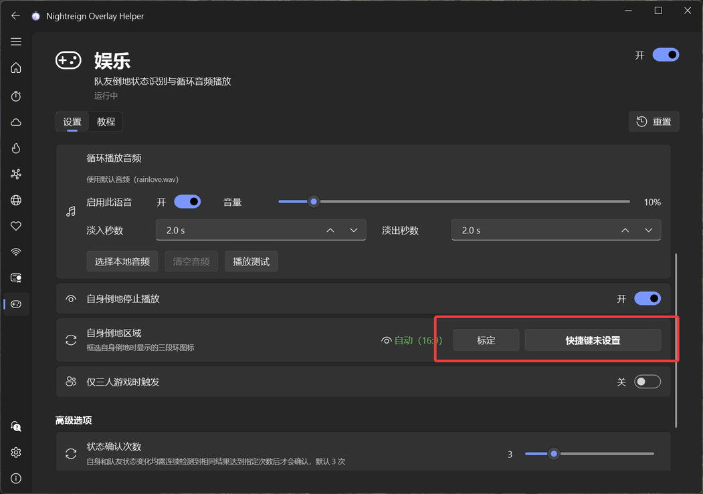
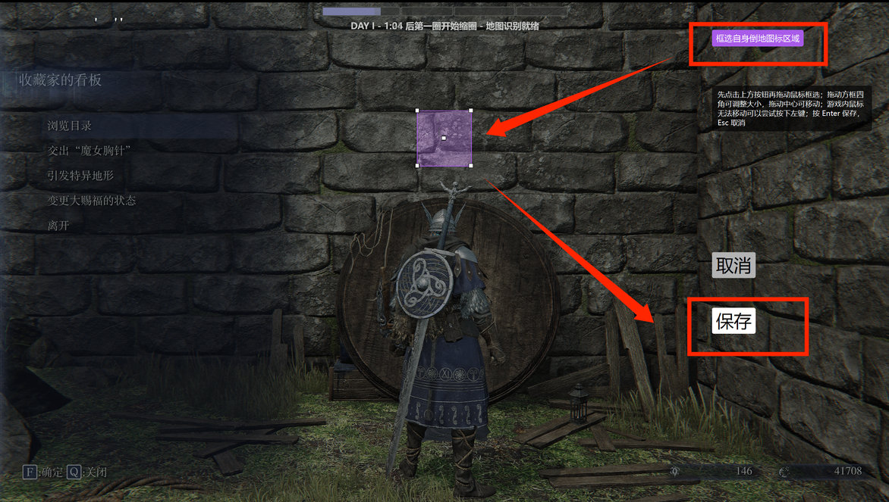
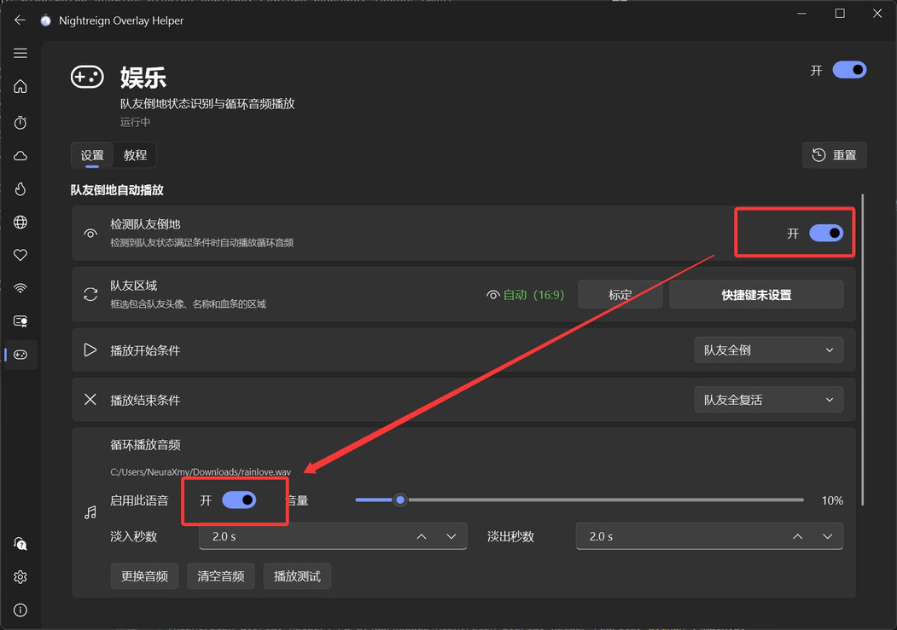

## 功能介绍

各种娱乐功能。目前包含检测队友倒地自动播放音频功能。

## 队友倒地自动播放-初次设置

### 1. 对倒地信息区域进行标定。

ℹ️ 该步骤**可跳过**，程序会根据 16:9 全屏游戏画面，自动计算出要检测的区域。

如果自动区域无法正常工作、游戏不是全屏，或者想识别其他非游戏窗口，请先查看 [标定教程](app://tutorial/region-calibration)

:::collapse 手动标定步骤

建议设置手柄或键盘快捷键，然后进入游戏中的训练场或者三人游戏的场景，按下快捷键进入标定界面。

点击右上角按钮开始框选（如果鼠标无法移动可以尝试按一下左键），框选**包含完整队友头像、血条的区域**或者**如下图所示训练场菜单界面的区域**，框选后按 Enter 或保存按钮进行确认。

此外若要让“自身倒地停止播放”功能正常生效，还需要标定自身倒地环的区域。

点击右上角按钮开始框选（如果鼠标无法移动可以尝试按一下左键），框选**包含完整倒地环的区域**（推荐多人模式倒地时截图，或者在该位置用墙面参考），框选后按 Enter 或保存按钮进行确认。

回到主界面，看到绿色“已标定”即成功，鼠标悬浮在眼睛图标上可以看到已标定的区域。

:::

### 2. 保证检测和音频都是启用状态

## 注意事项

其他无法识别、识别不准等问题，可参照“常见问题”页面。
