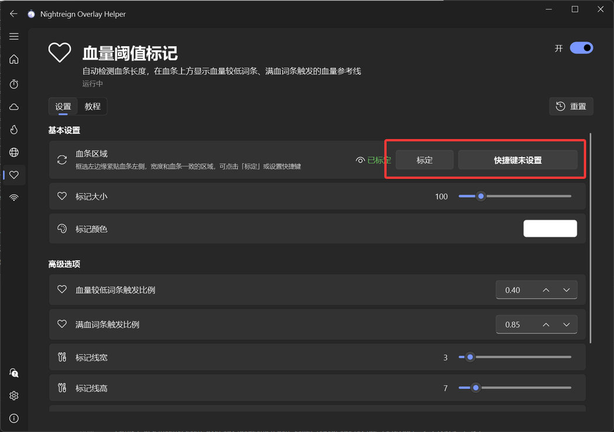
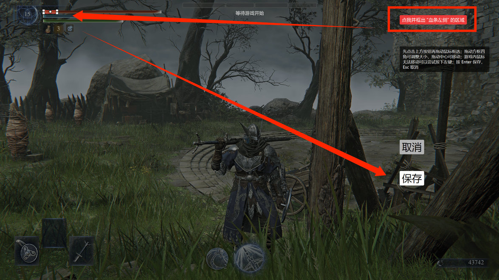
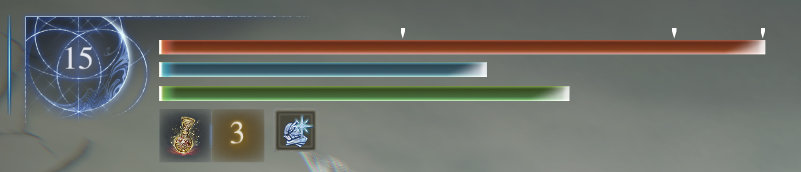

## 功能介绍

定时截图并检测血条长度，并显示游戏中“血量不满时xxx”、“血量较低时xxx”词条触发所需的血量阈值。

## 初次设置

### 1. 对血条区域进行标定。

ℹ️ 该步骤**可跳过**，程序会根据 16:9 全屏游戏画面，自动计算出要检测的区域。

如果自动区域无法正常工作、游戏不是全屏，或者想识别其他非游戏窗口，请先查看 [标定教程](app://tutorial/region-calibration)

:::collapse 手动标定步骤

建议设置手柄或键盘快捷键，然后进入游戏中的训练场或者任意有血条的场景，按下快捷键进入标定界面。

点击右上角按钮开始框选（如果鼠标无法移动可以尝试按一下左键），框选血条**左侧的一段**，框选后按 Enter 或保存按钮进行确认。

标定的区域应该如下所示，血条的**左侧的一段**，框的左边、上下边需要和血条的框贴紧。区域太小框起来不方便的话，可以先框个大区域，再调整四角。

回到主界面，看到绿色“已标定”即成功，鼠标悬浮在眼睛图标上可以看到已标定的区域。

:::

## 效果

显示标记从左到右分别为“血量较低时”词条阈值、“血量不满时”词条阈值、血条末端；可以在该功能的设置页面调整标记外观。

## 注意事项

稳定机制会导致血条消失后标记仍然显示、血条长度变化后一小段时间标记未改变，属于正常现象不影响使用。

血条的区域内不要有其他悬浮窗遮挡（比如缩圈计时的悬浮窗）。

其他无法识别、识别不准等问题，可参照“常见问题”页面。
