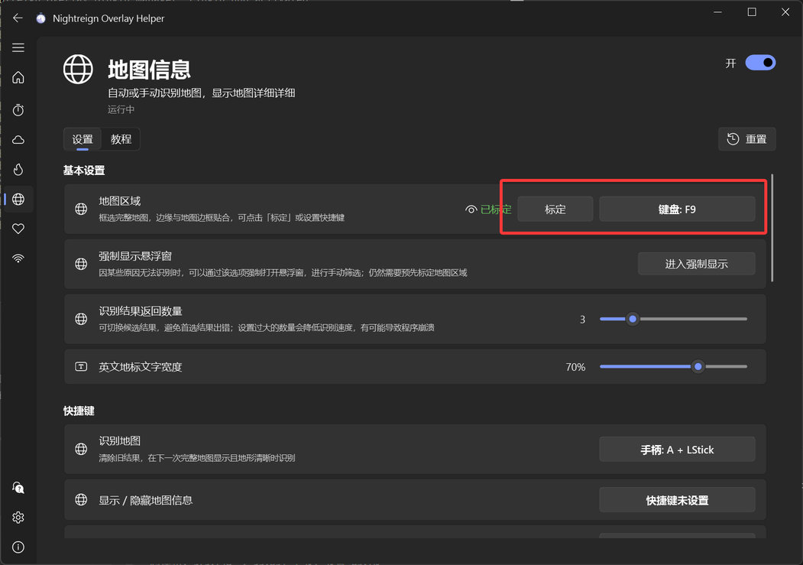
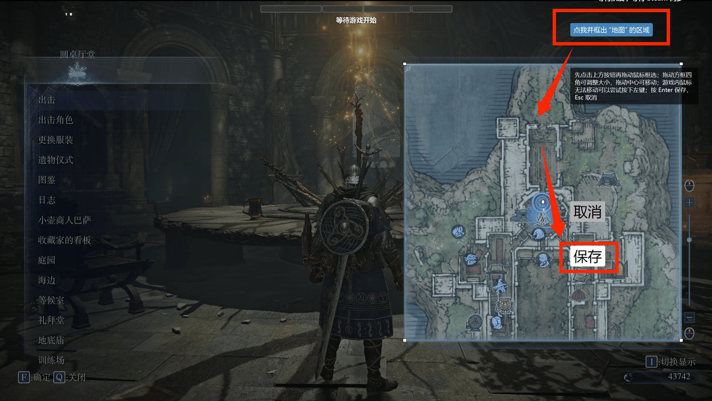
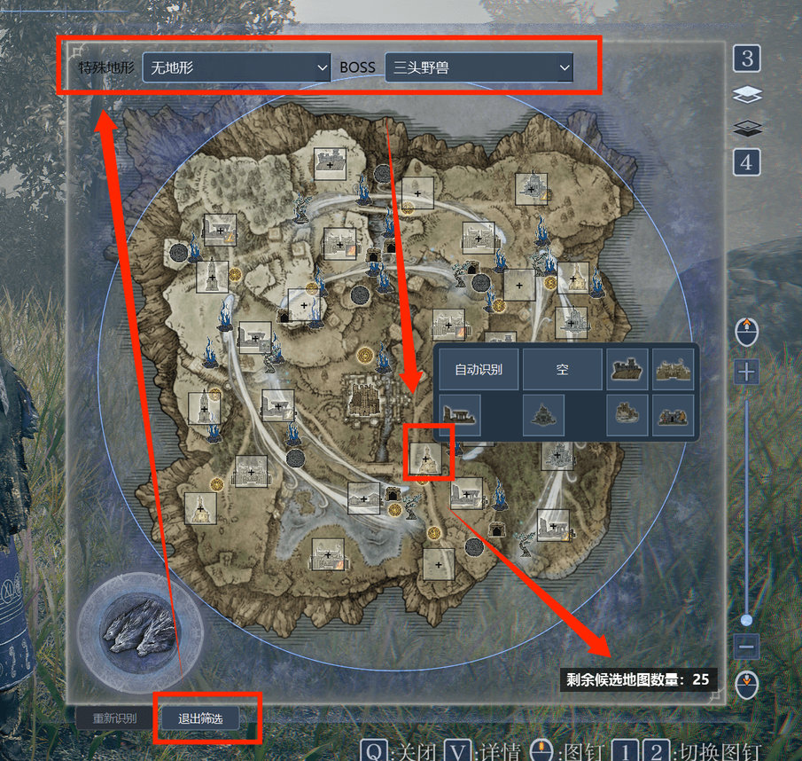
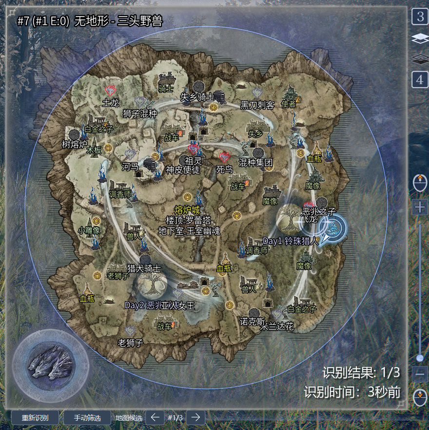

## 機能紹介

マップ上の特殊地形、夜王の肖像、拠点タイプを認識してマップシードを絞り込み、一致するシードの詳細な拠点情報を表示します。DLCを含むすべてのマップに対応し、夜王が隠れている場合やマップ詳細情報が隠されるイベントにも対応します（手動での絞り込みが必要な場合があります）。

## 注意

この機能は**通常のゲーム進行に大きな影響を与える可能性があります**。野良マッチや、チームメンバーと十分に意思疎通できていない状態での使用はおすすめしません。

## 初期設定

### 1. マップ範囲を指定します。

ℹ️ この手順は**省略できます**。プログラムは16:9の全画面ゲーム画面を基に、検出範囲を自動計算します。

自動範囲が正しく機能しない場合、ゲームが全画面でない場合、またはゲーム以外のウィンドウを検出したい場合は、[範囲指定チュートリアル](app://tutorial/region-calibration)を参照してください。

:::collapse 手動で範囲を指定する手順

コントローラーまたはキーボードのショートカットを設定することをおすすめします。大祝福などマップを開ける場面に入り、ショートカットを押して指定画面を開きます。

右上のボタンを押して範囲選択を開始します（マウスを動かせない場合は、左クリックを一度押してみてください）。**正方形のマップ範囲**を選択し、Enterキーまたは保存ボタンを押して確定します。

メイン画面に戻り、緑色の「指定済み」が表示されれば成功です。目のアイコンにカーソルを合わせると、指定した範囲を確認できます。

:::

### 2. 手動絞り込みを確認します。

認識に失敗した場合や、夜間にマップ詳細情報が隠されるイベントでは、画面下部のボタンから手動絞り込みモードに入ります。

まず特殊地形と夜王を選択し、その後マップ上の拠点位置を設定します。「自動認識」は、マップ情報が欠落するイベントで、拠点を制圧して拠点アイコンが表示された場合にのみ使用できます。

現在の候補マップ数は右下に表示されます。候補数が一定数を下回ると、絞り込みは自動的に終了します。

### 3. 認識を開始します

設定後、ゲーム内のミニマップが完全に開くと自動認識が始まります。

次のゲームで再び認識するにはどうすればよいですか？

1. 縮圈タイマーを有効にしている場合、DAY I の開始時に自動で再認識します。
2. 「再認識」ボタンを押すか、ショートカットを使用します。
3. 一度認識に成功すると、「詳細設定」にある「再マッチング間隔」に設定した秒数（おおよそ1ゲーム分）が経過した後、自動的に再認識します。

## 結果

左下のボタンまたはショートカットでマップ候補を切り替えられます。結果が正しくない場合は、別の候補が正しいか確認してください。

大空洞では、複数の結晶配置を切り替えることもできます。

## 注意事項

認識中にマップを何度も開閉しないでください。

認識できるのはマップが最小化されている場合だけで、拡大されたミニマップには対応していません。

その他の認識失敗や認識精度の問題については、「よくある質問」ページを参照してください。
