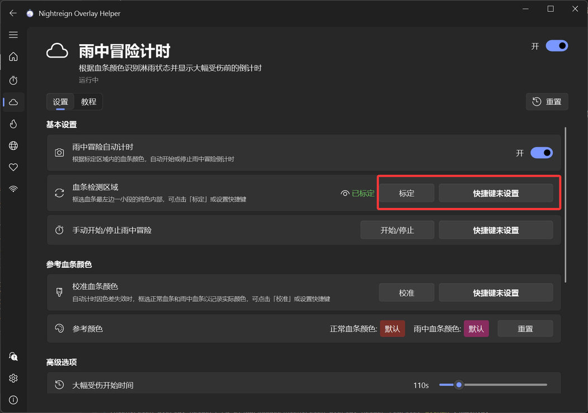
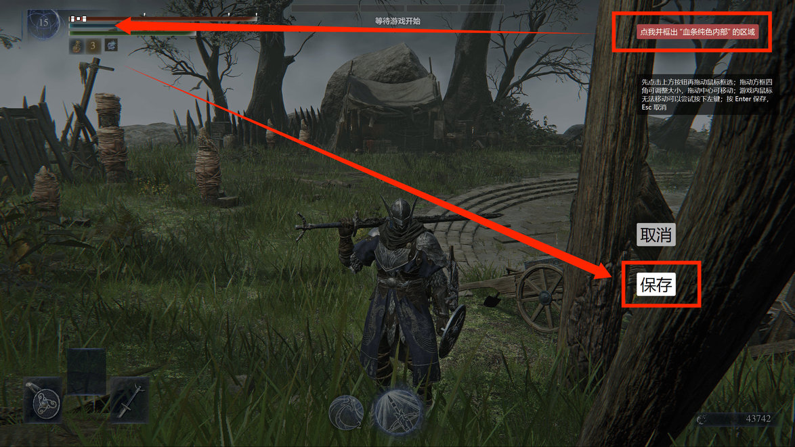
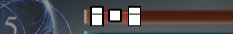
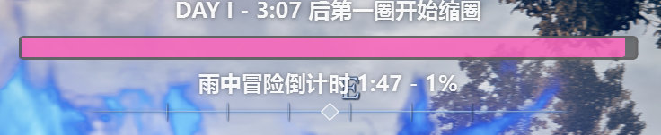

## Overview

The feature periodically captures screenshots and detects the HP bar color. When the bar changes to the Nightrain color, it starts a countdown shown on the overlay; when the countdown ends, the character begins taking heavy damage. The countdown stops automatically when the bar returns to its normal color.

## Initial setup

### 1. Calibrate the inside of the HP bar.

ℹ️ This step is **optional**. The program automatically calculates the detection region from a 16:9 full-screen game image.

If the automatic region does not work correctly, the game is not full screen, or you want to detect a window other than the game, see the [Calibration Tutorial](app://tutorial/region-calibration).

:::collapse Manual calibration steps

It is recommended to set a controller or keyboard shortcut. Then enter the training area or any scene with an HP bar, and press the shortcut to open the calibration screen.

Click the button in the upper-right corner to start selecting (if the mouse cannot move, try clicking the left mouse button once). Select **a small region inside the left side of the HP bar**, then press Enter or the Save button to confirm.

The calibrated region should be inside the HP bar and **as far to the left as possible**. **Do not** include the bar edges. If selecting a small region is inconvenient, select a larger area first and adjust its corners.

Return to the main window. A green "Calibrated" status indicates success. Hover over the eye icon to view the calibrated region.

:::

## Result

The appearance of the main overlay can be adjusted in the general "Settings".

## Notes

This feature is sensitive to color. Under extreme game brightness or HDR, the default colors may not be recognized correctly. In that case, try "Calibrate HP bar colors" in Settings: select the inside of the normal-color HP bar and the Nightrain-color HP bar once each, and the program will extract reference colors automatically.

For other recognition failures or inaccurate results, see the "FAQ" page.
