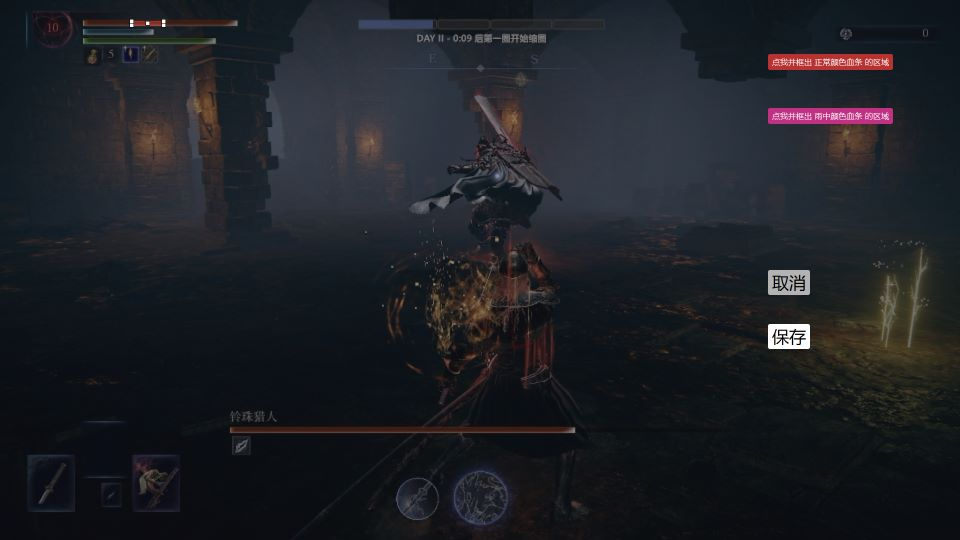
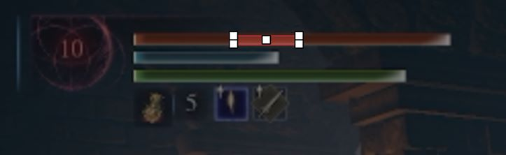

# 雨中冒险计时

雨中冒险自动计时的原理是**定时截图并检测血条颜色**：血条变为雨中颜色时开始倒计时，恢复为正常颜色时停止。因此需要先框选血条的检测区域。

## 设置检测区域

1. 在「基本设置」中点击「血条检测区域」的「标定」，或先为它设置快捷键，然后在游戏中按下快捷键。
2. 开始一局游戏，在画面中有血条时进行标定：画面会定格，并出现几个按钮（如果此时鼠标被锁定在屏幕中间，点一下左键即可）。
3. 点击「点我并框出 血条 的区域」按钮，然后用鼠标框选屏幕上的血条区域。框选的区域如下图所示，需要把血条的纯色内部框进去，尽量不要框到边框。

   ⚠️ 即使你画面里的血条可能更长，但也只需要框**【最左边的一小段】**！

   

4. 点击「保存」完成设置。之后正常游玩即可自动计时，若修改游戏分辨率则需要重新框选。

ℹ️ 雨中冒险计时可能失效的场景：当前血量过少 / 开启 HDR。

⚠️ 即使开启了自动计时，仍然推荐设置「开始/停止雨中冒险」快捷键作为备用。

## 校准血条颜色

ℹ️ 如果你设置完检测区域后能正常计时，则不需要进行校准。

雨中冒险自动计时有可能因为色差而失效，此时可以使用校准步骤：

1. 在「血条颜色校准」中为「校准血条颜色」设置快捷键。
2. 开始一局单人游戏，在画面中有血条时按下设置的快捷键，画面定格并显示出按钮。

   

3. 如果画面中有正常血条，则点击「点我并框出 正常颜色血条 的区域」按钮，然后拖动鼠标框出血条中的纯色部分，点击「保存」。

   

4. 以相同的步骤对在雨里的血条也框选一次（推荐单人去 roll 在圈外的出生点）。
5. 在设置界面看到两个颜色显示「已设置」即可，「重置」按钮可以退回到程序内置的默认颜色。

普通模式与 HDR 模式（「设置 → 启用 HDR 图像处理」）的颜色分别保存，校准和重置只影响当前模式。
