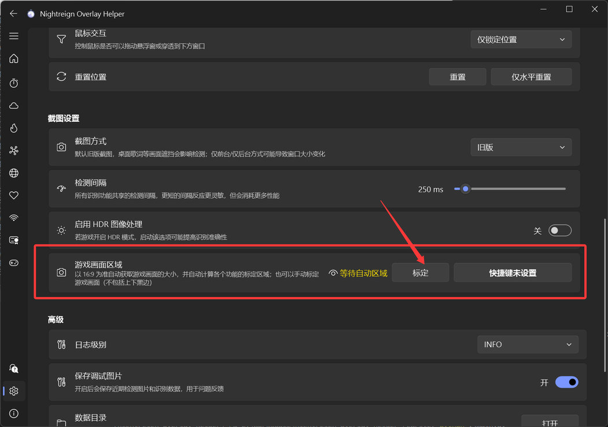

# 標定教學

### 正常情況：不需要手動標定

正常情況下，**無需手動標定**，可以略過教學中的標定步驟。

懸浮助手進入全螢幕遊戲後，會自動將**螢幕中央 16:9 的區域**視為遊戲畫面，並自動計算各區域大小。

此時各功能的標定分頁會以綠色字體顯示「自動（16:9）」。將滑鼠移到眼睛圖示上，可以查看自動計算的區域。

### 需要手動標定遊戲畫面的情況

如果：

- 遊戲不是無邊框視窗化的全螢幕模式。
- 需要偵測的不是遊戲視窗（例如 PS 串流畫面／遊戲錄影）。

請在一般「設定」頁面開啟「畫面擷取設定」→「遊戲畫面區域」，框選包含遊戲畫面的範圍（不包括黑邊）。

框選後顯示綠色「已標定」即表示成功。

### 需要手動標定各功能區域的情況

如果：

- 前述步驟設定後仍無效，而且預覽區域明顯錯誤（例如地圖標定區域與遊戲中的地圖對不上）。
- 遊戲畫面不是 16:9。

則需要在各功能的設定頁面中手動標定。

請前往各功能的教學，展開折疊內容，查看手動標定步驟。

### 注意事項

若辨識功能無效，除了調整標定以外，也可以嘗試更換「畫面擷取設定」→「擷取方式」。

其他問題請參閱「常見問題」頁面。
